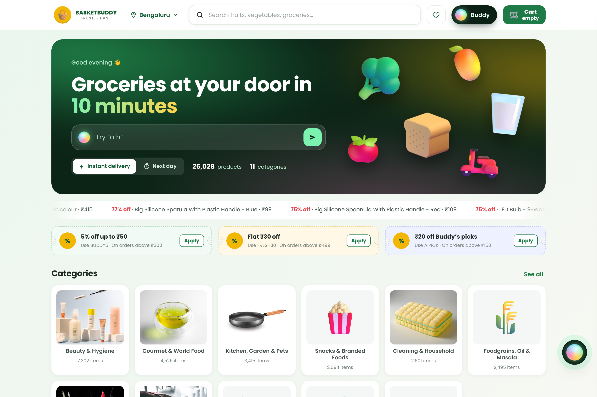
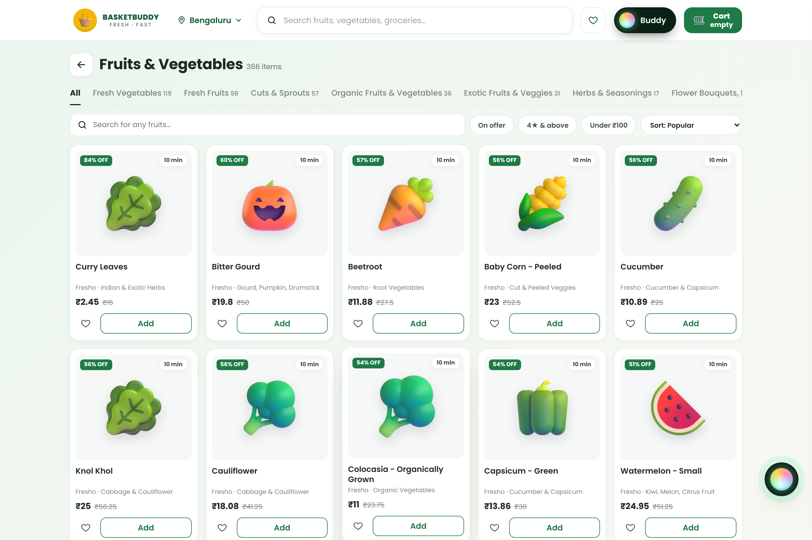
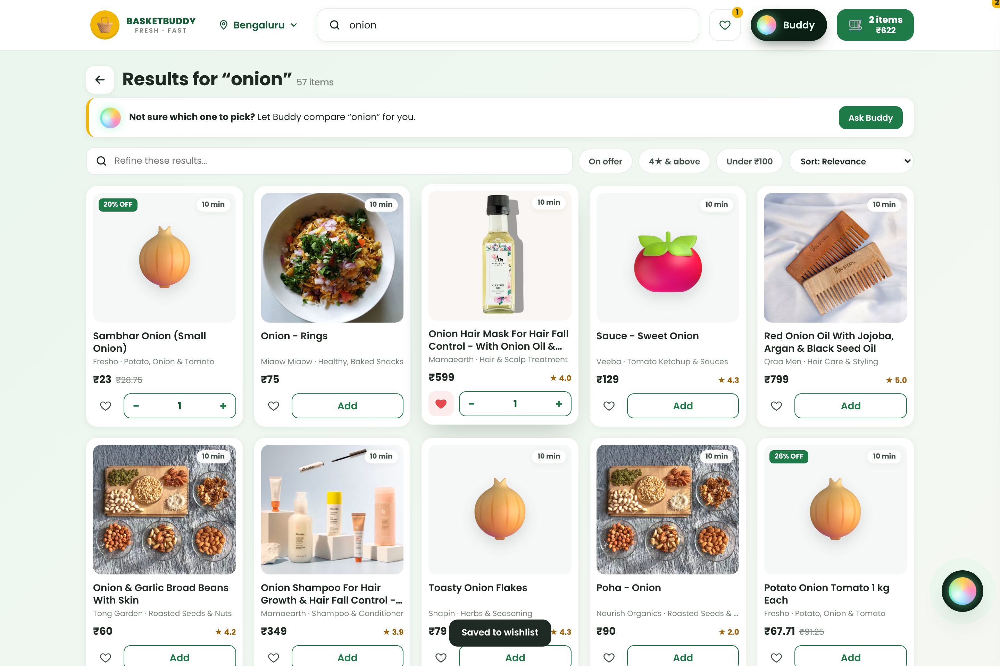
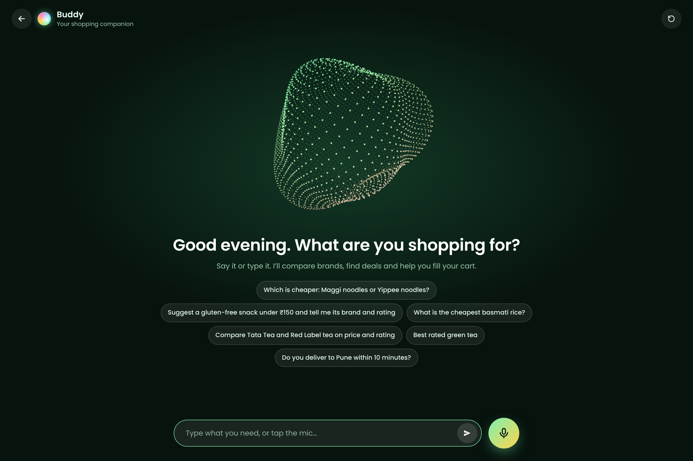
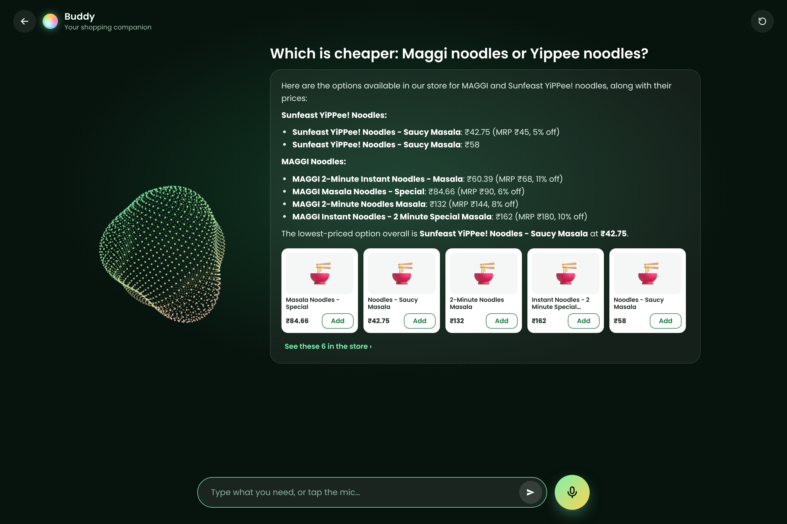
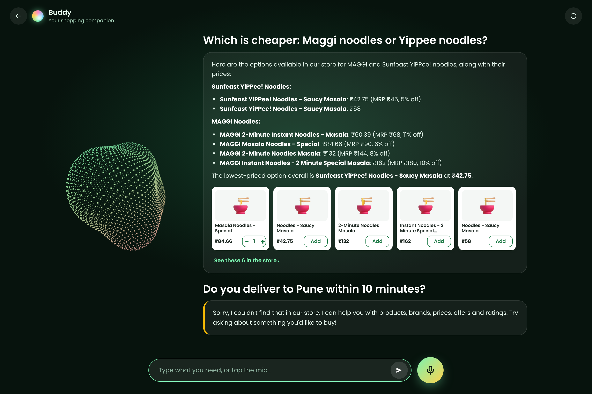
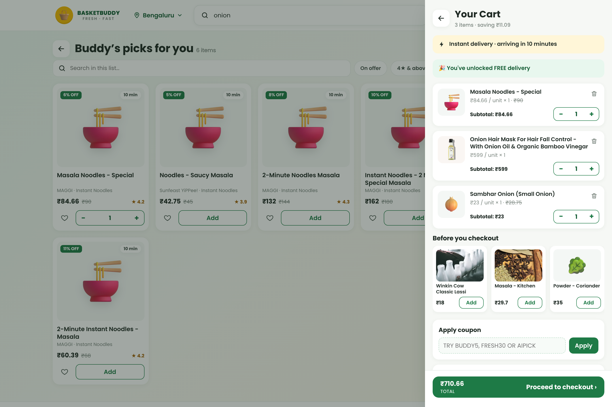
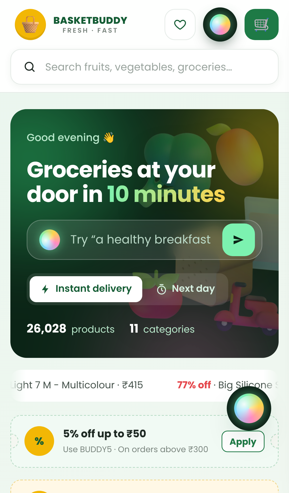
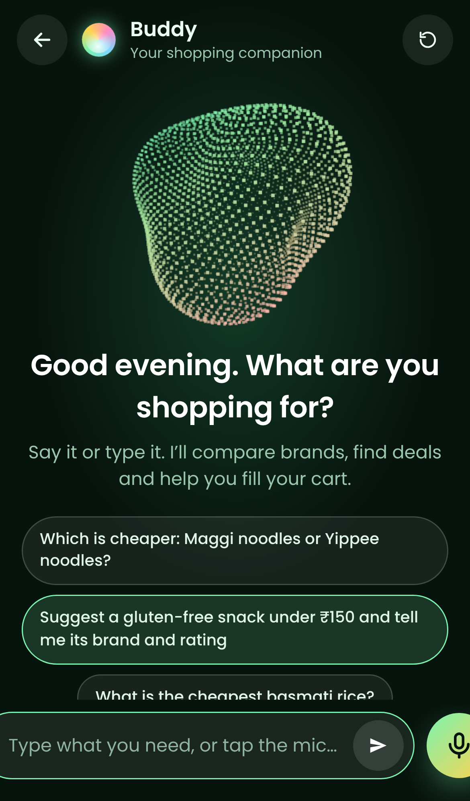

# 🧺 BasketBuddy: RAG shopping assistant for the BigBasket catalogue

A Retrieval-Augmented Generation (RAG) chatbot that helps shoppers discover and compare
products in **BigBasket's** online grocery catalogue. Answers are grounded only in the
retrieved product records; when the catalogue doesn't contain the answer, the bot says so.

**Industry:** Food & Grocery · **Company:** BigBasket
**User:** an online grocery shopper · **Purpose:** product discovery, comparison and Q&A
(price, MRP, discount, brand, rating, description/usage).

## Dataset
| | |
|---|---|
| Source | Kaggle — *BigBasket Entire Product List (~28K datapoints)* |
| License | CC BY-NC-SA 4.0 (non-commercial, attribution, share-alike) |
| Raw | 27,555 rows · 10 columns (`product, category, sub_category, brand, sale_price, market_price, type, rating, description`) |
| Coverage | 11 categories · 90 sub-categories · 426 product types |
| Description | median 62 words (75% under 95 words, max 734) |

**Cleaning** (`src/ingest.py`): trimmed whitespace; dropped rows with missing product name
or description (or descriptions under 20 characters); filled missing brand with "Unbranded";
removed exact duplicates (same product, brand, prices and description). Same-name products
with different prices are kept because they are usually different pack sizes. Added a derived
`discount_pct` column.

**Assumptions / limitations:** the data is a snapshot, so prices may be out of date. There are
no pack-size, stock, delivery, offer or return-policy fields, so the bot treats those questions
as unsupported. About 31% of products have no rating and are shown as "Not rated".

## Pipeline
```
CSV ──► clean ──► one document per product ──► chunk long descriptions
                    (header + description)        (800 chars, 100 overlap)
                                                         │
                                       FastEmbed all-MiniLM-L6-v2 (384-d)
                                                         │
                        FAISS (inner product = cosine) + BM25 keyword index
                                                         │
   question ──► price filter parse ──► hybrid retrieval (RRF fusion) ──► top-k chunks
                                                         │
                         relevance gate ── below threshold ──► "not in catalogue" fallback
                                                         │
                       grounded prompt + context ──► OpenRouter LLM ──► answer + sources
```

1. **Data**: the cleaned CSV is saved to `data/processed/products_clean.csv`.
2. **Chunking**: **record-based**. Each product becomes one document: a structured header
   (product, brand, category path, price/MRP/discount, rating) followed by the description.
   Most descriptions are short (median 62 words), so splitting them would separate facts from the
   product they describe. Only descriptions longer than **800 characters** are split with
   `RecursiveCharacterTextSplitter`, with **100 characters of overlap** so a sentence cut at the
   boundary is still found. Every piece repeats the product header so it stays self-contained.
3. **Embeddings**: `sentence-transformers/all-MiniLM-L6-v2` through FastEmbed (ONNX, CPU, free,
   no API key). 384-dim normalised vectors, 256-token limit (fits our 800-char chunks). We first
   tried `bge-small-en-v1.5`, but on our CPU it embedded only ~5 docs/s (~95 min for the catalogue);
   MiniLM is ~20× faster with comparable retrieval quality for short product text.
4. **Vector store**: **FAISS** (`MAX_INNER_PRODUCT`, so scores are cosine similarity), saved to
   `vectorstore/faiss_index` and loaded at startup. All metadata (price, brand, rating…) is
   kept on each chunk.
5. **Retrieval (Hybrid RAG + query decomposition)**
   - **Hybrid**: we fetch 40 candidates from **FAISS** (semantic: "healthy breakfast" → oats) and 40 from
     **BM25** (keyword: exact brands such as "Saffola", "Yippee"; text is lower-cased and filler words
     are removed), then merge the two lists with **Reciprocal Rank Fusion**, `score = Σ 1/(60 + rank)`.
   - **Query decomposition** (for comparisons): "Compare Tata Tea and Red Label tea on price" →
     sub-queries `tata tea` and `red label tea`. Each one is retrieved separately and the results are
     interleaved, so both items appear in the context. Without this, one brand filled the top-k.
   - **Metadata filtering and sorting**: price phrases ("under ₹150", "between 100 and 300") filter on
     `sale_price`; "cheapest", "highest discount" and "best rated" re-sort the top 15 relevant
     candidates by price, discount or rating. Vector search can't compare numbers, so we do it here.
   - **De-duplication**: one chunk per listing (same name, brand and price). The top **k = 6** go to the LLM.
6. **LLM + context**: a chain of free models across two providers, all called through the
   OpenAI-compatible API: OpenRouter `gemma-4-26b-a4b-it:free` → `gemma-4-31b-it:free` →
   **Google Gemini** `gemini-3.5-flash` → `gemini-flash-lite-latest` → OpenRouter `nemotron-3-ultra`.
   Temperature 0. Providers without a key are skipped. If a model is rate-limited (429) or returns an empty or truncated answer (reasoning
   models can spend the whole token budget "thinking"), we try the next one. The system prompt
   tells it to answer only from the context, name the products, and never invent ratings or services.
7. **Answer + fallback**: there are two layers. (a) **Relevance gate**: if the best semantic similarity
   is below **0.45**, the bot returns a fixed "not in the catalogue" message **without calling the
   LLM**. We chose the threshold from the test questions: in-catalogue questions scored 0.61–0.84 and
   off-topic ones 0.21–0.40. (b) **Prompt rule**: the LLM says when the context is insufficient, or
   which part of a multi-part question it can't answer. The UI shows the source chunks under every answer.

## Evaluation
`python evaluate.py` runs 11 test questions and writes [`docs/evaluation.md`](docs/evaluation.md):
it records the best similarity, whether the retrieved chunks contain the needed evidence (vector-only
vs hybrid), whether the bot fell back, and the full answer.

| Type | Example | Result |
|---|---|---|
| Factual | What is Himalaya Neem Face Wash used for? | ✅ evidence retrieved, grounded answer |
| Comparison | Which is cheaper: Maggi or Yippee noodles? | ✅ both brands retrieved (after query decomposition) |
| Multi-part | Gluten-free snack under ₹150 + its brand and rating | ✅ price filter applied, unrated items say "Not rated" |
| Sorting | Cheapest basmati rice? | ✅ Fortune Rozana ₹71 |
| Unsupported | Delivery to Pune in 10 min / refund policy / cricket | ✅ all fall back (similarity 0.31–0.36) |

**Improvements found by testing:**
- BM25 originally split on whitespace only, so "Yippee?" never matched "YiPPee!". Normalising the
  tokens fixed it.
- Comparisons returned only one brand until we added query decomposition.
- A 0.60 threshold would have rejected "Saffola Gold oil" (0.617). We lowered it to 0.45.
- Empty answers came from reasoning models running out of tokens. We now detect them and fall back.

### Failure cases and how we would fix them
1. **Overclaiming on "highest" questions.** For *"Which baby diapers have the highest discount?"*,
   the LLM said "the highest discount **in the catalogue** is 28%", but we only sort the top 15
   retrieved diapers, not all of them. *Fix:* send aggregate questions (max, min, count) to a
   structured pandas query over the cleaned CSV, or have the prompt say "among the matching products".
2. **Brand-only comparisons drift off-topic.** For *"Compare Amul and Nestle milk products"*, the
   sub-query `amul` loses the word "milk" and retrieves Amul cookies and butter. *Fix:* carry the
   shared noun into each sub-query (`amul milk products`), decompose with the LLM instead of regex,
   or filter by category/type metadata.
3. **Missing pack size.** *"Price of Saffola Gold oil?"* returns ₹1,024 and ₹2,525 listings, and the
   dataset has no size column to explain the difference. *Fix:* extract pack size and unit from the
   product name or description into metadata and add it to the chunk header.
4. **Free-tier LLM reliability.** Free models get rate-limited and change often. *Fix (in place):*
   a model fallback chain. For the demo, a paid model costing a few cents.

## The app
BasketBuddy is an original **grocery storefront** (demo) with the RAG assistant built in. Its soft
fresh-market style uses mint/cream backgrounds, white rounded cards, a greeting header, a delivery-slot
banner, coupon tickets, photo category tiles, and a cart of item cards. The storefront is real
HTML/CSS/JS mounted in Streamlit as a **Custom Component v2**, so it renders in the page with no
iframe and talks to Python through trigger values. It is still a single Streamlit app
(`streamlit run app.py`).

| Feature | How it works |
|---|---|
| Home page | Greeting + Instant / Next-day delivery toggle, delivery-slot banner, 3 demo coupons, category tiles, product rails |
| Browse | Category pages with sub-category tabs, in-page search, filter chips (on offer / 4★+ / under ₹100), sorting |
| Search | Instant type-ahead in the browser, then **hybrid RAG retrieval** in Python (BM25 + FAISS + RRF) |
| Product page | Photo, price, MRP, discount, rating, full description from the index, wishlist, "Ask AI" |
| Wishlist | Heart on every card, wishlist page (saved in the browser) |
| Cart | Item cards with unit price × qty, subtotal, stepper and remove; delivery note; free-delivery progress; "Before you checkout" picks; demo coupons; bill details; demo checkout (no payment) |
| **BasketBuddy AI** | Chat drawer calling `rag.answer()`: grounded answer, product cards you can add to the cart, "view in store", and "How I found this" (similarity, decomposition, filters, model, time). Unsupported questions get the fallback. |
| Classic chat | `/chat` page with Streamlit's `st.chat_input` and the same pipeline (the brief's requirement) |

**Data flow:** `static/catalog.json` (slim catalogue exported from the index, about 1 MB gzipped) loads once in
the browser for browsing and the basket. Search, chat and product descriptions round-trip to Python.
LLM output and dataset text are HTML-escaped before rendering.

**Images:** the dataset has no product images. Each product is mapped to an image concept
(item keyword → product type → category; 169 concepts). Each concept gets an **illustrative Unsplash
photo** (`scripts/fetch_photos.py`, hotlinked with photographer credit as the Unsplash API guidelines
require), falling back to a **Microsoft Fluent Emoji 3D** illustration (MIT) where no photo was picked.

| Home | Category | Search + cart |
|---|---|---|
|  |  |  |
| **Buddy (assistant)** | **Buddy answering** | **Buddy fallback** |
|  |  |  |
| **Cart** | **Mobile** | **Mobile Buddy** |
|  |  |  |

**Buddy** is the assistant's full-screen mode: an animated particle orb (canvas), voice input through the
browser's Web Speech API where available, typed input everywhere, answers with add-to-cart product cards.
Append `?demo=1` to the URL to show the retrieval details for a presentation.

*Demo store for a student project. Not affiliated with or endorsed by BigBasket. No real orders or payments.*

## Project structure
```
app.py                    Entry point: routes to the store and classic chat pages
views/store.py            Storefront page: mounts the component, handles search/ask/details
views/classic_chat.py     Streamlit st.chat_input chat over the same pipeline
frontend/store.{js,css}   Storefront UI (Custom Component v2)
src/config.py             All settings (chunk size, k, threshold, models)
src/ingest.py             Clean → chunk → embed → FAISS
src/embeddings.py         Embedding model (shared by ingest + query)
src/rag.py                Hybrid retrieval, decomposition, filters, fallback, LLM chain
src/images.py             Product → illustration mapping
src/shared.py             Cached loaders shared by the pages
scripts/export_catalog.py Builds static/catalog.json from the index
static/                   catalog.json + Fluent Emoji 3D images (served by Streamlit)
evaluate.py               Test questions → docs/evaluation.md
data/raw/                 Original Kaggle CSV
vectorstore/              Saved FAISS index
```

## Run locally
```bash
pip install -r requirements.txt
cp .env.example .env          # add OPENROUTER_API_KEY and/or GEMINI_API_KEY
streamlit run app.py          # the prebuilt index in vectorstore/ loads in about 6 s
```
Rebuild the index (only if you change the data or chunking): `python -m src.ingest` (about 12 min on CPU), then `python -m scripts.export_catalog`.

## Deploy on Streamlit Community Cloud
1. Go to [share.streamlit.io](https://share.streamlit.io) → **Create app** → *Deploy a public app from GitHub*.
2. Repository `Justinsharon/Bigbasket`, branch `main`, main file `app.py`.
3. **Advanced settings** → Python **3.13**, then under **Secrets** paste:
   ```toml
   OPENROUTER_API_KEY = "sk-or-..."
   GEMINI_API_KEY = "AIza..."
   ```
4. Deploy. The first start downloads the embedding model (about 90 MB) and loads the index.
